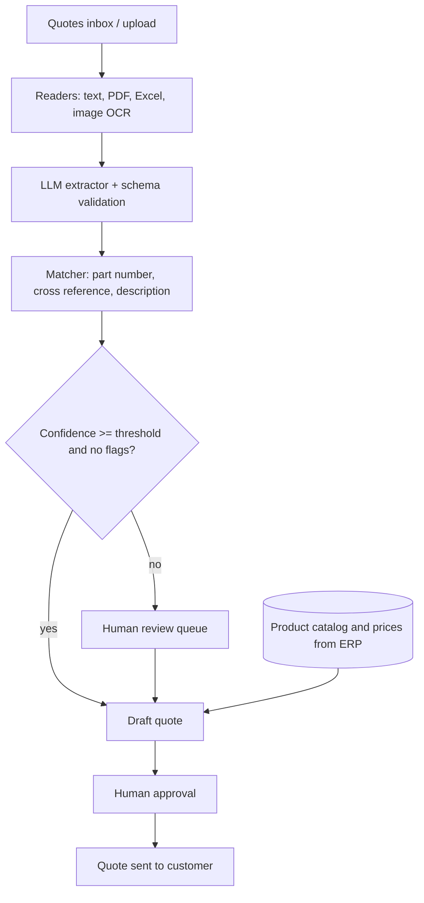

# Ridgeline Quote Desk

Turns customer RFQs (email text, PDF, Excel) into structured line items matched to Ridgeline part numbers. Every quote is reviewed and approved by a human; the model never generates prices and nothing is sent automatically.

## Repository

https://github.com/AbidAli-274/FDE-Challenge

## How to Run

Requires Python 3.9+.

```bash
pip install -r requirements.txt
cp .env.example .env          # then set GROQ_API_KEY in .env (never commit it)

PYTHONPATH=src python -m ridgeline.pipeline   # writes outputs/<rfq>.json for every file in rfqs/
python evaluation/evaluate.py                 # prints metrics, writes evaluation/results.json
python check_submission.py                    # format check
```

On Windows PowerShell, set the path first: `$env:PYTHONPATH="src"`.

`GROQ_MODEL` and `GROQ_BASE_URL` in `.env` are optional overrides.

## Approach

1. **Readers** (`src/ridgeline/readers/`): one per format (email text, PDF, Excel) returning plain text or simple rows.
2. **Extractor** (`extractor.py`): one shared LLM call turns the text into line items through a forced tool call. The prompt says never invent values, use null when unknown, and never output prices. Each line is then validated against the pydantic schema; a line that fails becomes a flagged `unparseable` line instead of a guess.
3. **Matcher** (`matching/matcher.py`), in order: exact Ridgeline part number, then cross reference, then fuzzy description match. Each line gets a `match_method` and a `confidence`. Discontinued parts are replaced by their successor, and ambiguous cross references are left unmatched with a note.
4. **Review flag**: `needs_review` is true when confidence is below 0.8, there is no match, or the line has any flag.
5. **Special cases**: the handwritten image (rfq_04) is a stub with one line, flag `stub` and the reason in `note`. rfq_05 and rfq_06 run through the normal path, and anything the pipeline cannot handle is flagged.

The pipeline never reads `answer_key/`; only the evaluation script does. The API key is read from the environment only.

## Evaluation

`python evaluation/evaluate.py` compares `outputs/` with `answer_key/` for the three keyed RFQs (19 lines) and writes `evaluation/results.json`.

| Metric (threshold 0.8) | Value |
|---|---|
| Extraction accuracy (quantity and unit correct) | 0.74 |
| Match precision (of lines accepted without review) | 1.0 |
| Match recall (of lines that have an expected part number) | 0.59 |

The script also prints how many lines are correct at each confidence cutoff, to help choose the threshold. On this small sample precision stays at 1.0 down to 0.5, while recall rises to about 0.94 at 0.55, so the threshold could probably be lowered. Only 19 lines are keyed, so treat these numbers as indicative.

## Production



- Prices come only from the ERP price list, never from the model; a salesperson approves every quote before it is sent.
- Add an image reader for handwritten RFQs such as rfq_04, which is a stub today.
- Check where the LLM provider processes data against the US-only requirement, and use a provider or region that meets it.
- Tune the threshold and the matcher scores on a larger labelled set, and track precision and review rate over time.
- Keep the API key in a secrets manager, and log failures without logging customer data.
